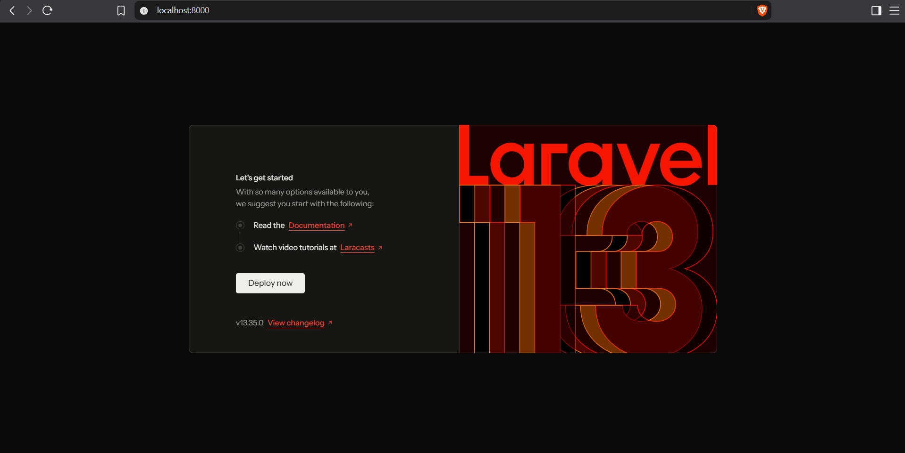
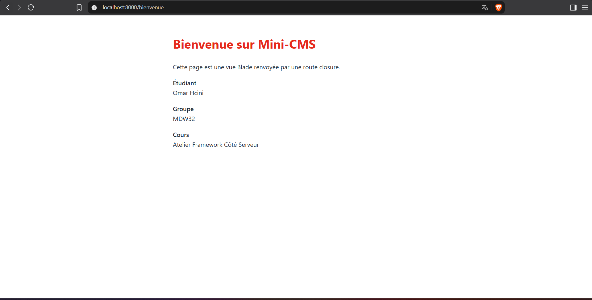
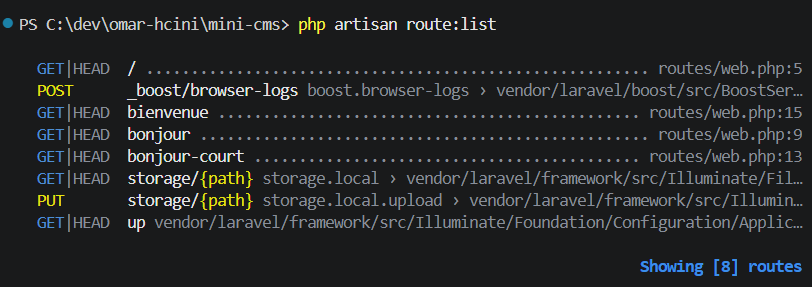
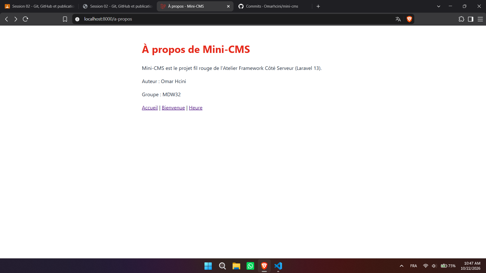

# Mini-CMS

Projet fil rouge de l'Atelier Framework Côté Serveur (Laravel 13, PHP 8.3+), 3e année MDW, ISET Sidi Bouzid.

Auteur : Omar Hcini, groupe MDW32.

Mini-CMS évoluera au fil du semestre vers une petite plateforme de publication : pages publiques, back-office authentifié, API JSON et tests Pest. Chaque session se termine par un tag Git (`lab-01`, `lab-01b`, puis un tag par session).

## État actuel (tag lab-01b)

- Routes en closures : `/`, `/bonjour`, `/bonjour-court`, `/bienvenue`, `/version`, `/heure` et `/a-propos`.
- Vues Blade : `bienvenue`, `heure` et `a-propos`.
- Base de données SQLite locale (`database/database.sqlite`, non versionnée).

## Routes disponibles

| Méthode | URI | Réponse |
|---|---|---|
|  GET|HEAD  / ........................................................................................................................ routes/web.php:5
  POST      _boost/browser-logs ............................................ boost.browser-logs › vendor/laravel/boost/src/BoostServiceProvider.php:106
  GET|HEAD  a-propos ................................................................................................................ routes/web.php:28
  GET|HEAD  bienvenue ............................................................................................................... routes/web.php:15
  GET|HEAD  bonjour .................................................................................................................. routes/web.php:9
  GET|HEAD  bonjour-court ........................................................................................................... routes/web.php:13
  GET|HEAD  heure ................................................................................................................... routes/web.php:22
  GET|HEAD  heure-court ............................................................................................................. routes/web.php:26
  GET|HEAD  storage/{path} ....................... storage.local › vendor/laravel/framework/src/Illuminate/Filesystem/FilesystemServiceProvider.php:111
  PUT       storage/{path} ................ storage.local.upload › vendor/laravel/framework/src/Illuminate/Filesystem/FilesystemServiceProvider.php:119
  GET|HEAD  up ............................................ vendor/laravel/framework/src/Illuminate/Foundation/Configuration/ApplicationBuilder.php:224

## Prérequis

- PHP et Composer (PHP 8.3 ou plus depuis https://www.php.net/downloads, avec les extensions curl, fileinfo, mbstring, openssl, pdo_sqlite, sqlite3 et zip activées dans php.ini, et Composer depuis https://getcomposer.org).
- Node.js LTS et npm.
- Git.

## Installation

### Bash (Git Bash, macOS, Linux)

```bash
git clone https://github.com/Omarhcini/mini-cms.git
cd mini-cms
composer install
npm install
cp .env.example .env
php artisan key:generate
touch database/database.sqlite
php artisan migrate
composer run dev
```

### PowerShell (Windows)

```powershell
git clone https://github.com/Omarhcini/mini-cms.git
cd mini-cms
composer install
npm install
copy .env.example .env
php artisan key:generate
New-Item database\database.sqlite -ItemType File
php artisan migrate
composer run dev
```

Ouvrir ensuite http://localhost:8000 (adresse de l'application, différente de l'adresse de Vite sur le port 5173).

## Captures d'écran

### Page d'accueil



### Page Bienvenue



### Liste des routes



### Page À propos

